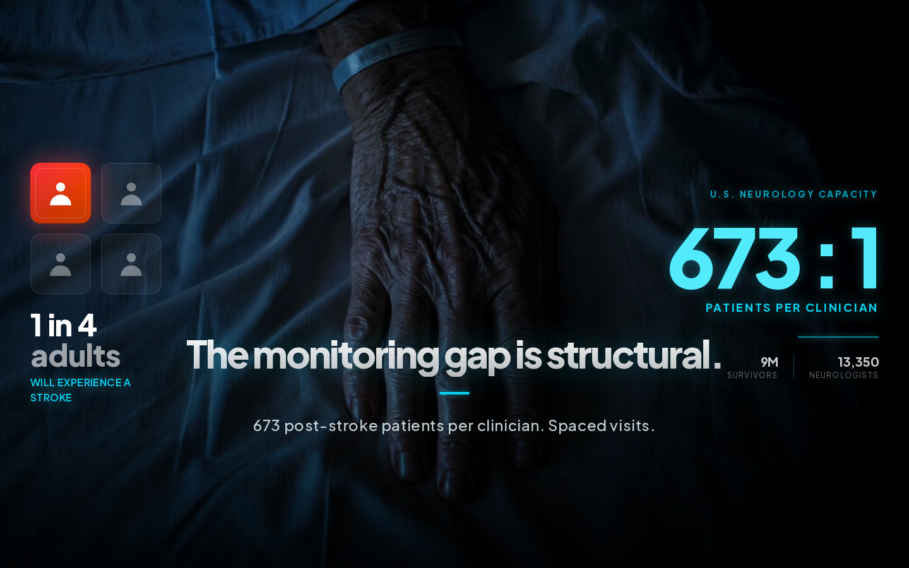
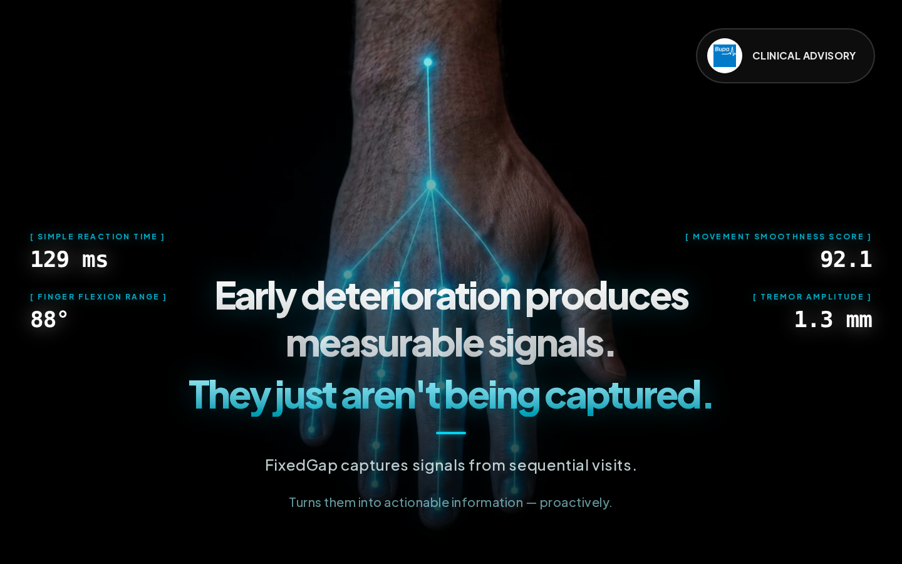
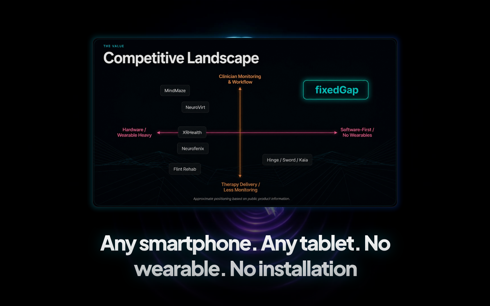

# FixedGap landing page

Scroll-driven landing page for FixedGap (the project started under the name SteadyArc, hence the repo name): a software-only way to monitor stroke recovery between clinical visits.

Live: https://steadyarc-bootcamp1-landing.vercel.app



## What it is

FixedGap came out of a startup bootcamp the team went through together. Post-stroke patients see their clinician rarely, and decisions in between rely on what the patient remembers. The original idea was a smart glove; it was later simplified into pure software, where a phone or tablet camera tracks hand movement, gaze and voice while the patient plays a short game at home, and the clinician gets a dashboard with objective data from each session.

This repo is the one-page site built to tell that story to clinicians, partners and investors: problem, product, team, supporters (Bupa, Harvard RCC, AWS, Saturno Labs, Oakley Capital), fundraising ask, next steps and a demo video.

## How it works

- The whole page is a single `ScrollCanvas` component. A 1164-frame image sequence in `public/frames/` is drawn onto a `<canvas>`, and the frame index follows scroll position, so the page behaves like a scrubbable video.
- Text sections fade in and out at fixed frame ranges defined in `app/ScrollCanvas.tsx`.
- `ClinicalDashboard.tsx` and `NeuralDashboard.tsx` are mock dashboards (Recharts) overlaid on the canvas at certain frames to show what the clinician side looks like.
- Later sections (team, supporters, fundraising, roadmap) are regular HTML revealed with an IntersectionObserver.
- Frames are preloaded before the page becomes interactive, so the first load is heavy (around 350 MB of JPEGs). That is a known trade-off of the approach.



The computer-vision metrics section. The four numbers are mock values that tick while the section is on screen.



The value section, further down the scroll.

## Stack

Next.js 16 (App Router), React 19, TypeScript, Tailwind CSS 4, Recharts.

## Run it

```bash
npm ci
npm run build
npm start
```

For development use `npm run dev` and open http://localhost:3000.

## Team

Luis Molina Salvador, Mateo Perez, alvarog-prog, marcusen78-sketch.

Demo video: https://youtu.be/WgE6esrREjI
